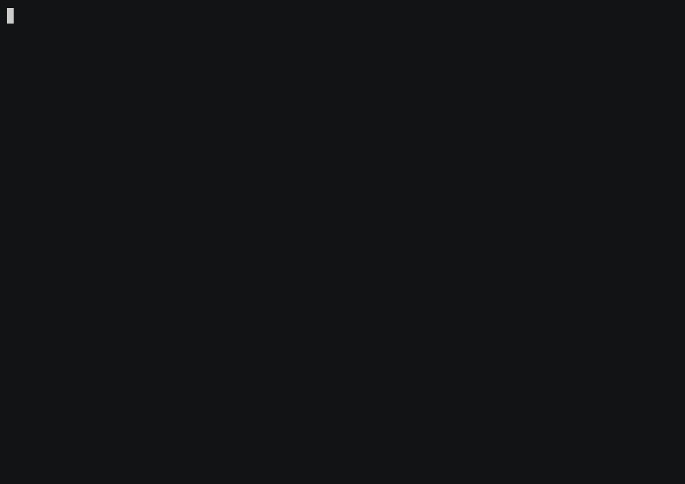

# Drug Interactions & Pharmacogenomics KG — Case Study

Drugs, their gene targets, side effects, indications and bioactivity, integrated
from five open pharmacology sources. The graph turns clinical-decision-support
questions — "what's the side-effect burden of this drug?", "which two drugs
compete at the same target?" — into single traversals.



```bash
cd case_studies/drug-interactions && ./run.sh        # validate every query
RECORD=1 ./run.sh                                    # also regenerate demo.gif
```

## The graph

**Scale:** 244,783 nodes · 387,577 edges (from an 8 MB snapshot)

| Node label | Count | Key properties |
|------------|-------|----------------|
| Bioactivity | 208,025 | target_name, pchembl_value, standard_type |
| Drug | 19,842 | name, drugbank_id, cas_number |
| Gene | 6,449 | gene_name |
| SideEffect | 5,858 | name, meddra_id |
| Indication | 2,844 | name, meddra_id |
| AdverseEvent | 1,765 | term |

**Relationships:** `BIOACTIVITY_TARGET` (180K), `HAS_SIDE_EFFECT` (139K),
`INTERACTS_WITH_GENE` (35K), `HAS_ADVERSE_EVENT` (18K), `HAS_INDICATION` (15K).

## Showcase queries

See [`queries.cypher`](queries.cypher): side-effect burden → busiest drug-target
genes (CYP enzymes surface naturally) → **polypharmacy risk** (drug pairs sharing
the most gene targets — a two-hop graph join that's the backbone of interaction
checking) → most widespread side effects → most-indicated drugs → adverse-event
volume. Every query returns real rows (DoD-gated).

## Question catalog

[`drug-interactions.sgqueries`](./drug-interactions.sgqueries) holds 57 questions
(17 easy, 27 medium, 13 hard; four unanswerable), built with `catalog-build --release`
against the pinned snapshot. [`questions.json`](questions.json) is its source, and the
NLQ accuracy benchmark
([competitor-benchmarks#260](https://git.samyama.ai/Samyama.ai/samyama-graph-competitor-benchmarks/issues/260))
reads it as its question set. Every entry is checked
weekly against the published snapshot by
[`kg-catalogs.yml`](../../.github/workflows/kg-catalogs.yml).

```bash
samyama queries list case_studies/drug-interactions/drug-interactions.sgqueries
samyama queries run  case_studies/drug-interactions/drug-interactions.sgqueries --snapshot druginteractions.sgsnap \
    --entry <id> [--param name=value]...
samyama verify druginteractions.sgsnap --queries case_studies/drug-interactions/drug-interactions.sgqueries
```

Names are unique per label (no two `Drug`, `Gene`, `SideEffect`, `Indication` or
`AdverseEvent` nodes share a name), and each drug-gene, drug-side-effect,
drug-indication and drug-adverse-event pair has one edge, so counts need no `DISTINCT`.
SIDER side effects are mixed case (`Nausea`); FDA adverse event terms are upper case
(`NAUSEA`), so a question comparing the two matches them ignoring case.

**Data caveats the catalog surfaces.**
- `Bioactivity` records link only to `Gene` targets, never to a `Drug`, so "what was
  measured for drug X" cannot be answered (`di_unanswerable_drug_ic50`).
- 13,479 of the 19,842 drugs have no edge at all (`di_isolated_drugs`), and some
  well-known drugs (Fluoxetine, Paroxetine) have side effects but no gene interactions.
- `HAS_INDICATION` mixes three extraction methods (`NLP_indication`,
  `NLP_precondition`, `text_mention`), so an "indication" can be a precondition such
  as asthma for a beta blocker; `di_indication_true_drugs` keeps only `NLP_indication`.
- 21,075 of the 35,066 drug-gene interactions have no `interaction_type`.
- FDA adverse events are capped at the 50 most-reported terms per drug, so many drugs
  tie at 50 terms; the catalog ranks by report count instead.

## Data & license

Sources: DrugBank, DGIdb, SIDER, ChEMBL, OpenFDA (see the
[`druginteractions-kg`](https://github.com/samyama-ai/druginteractions-kg)
loader for per-source licensing). Snapshot `druginteractions.sgsnap` on release
[`kg-snapshots-v5`](https://github.com/samyama-ai/samyama-graph/releases/tag/kg-snapshots-v5)
(sha256 pinned in [`case.env`](case.env)).
